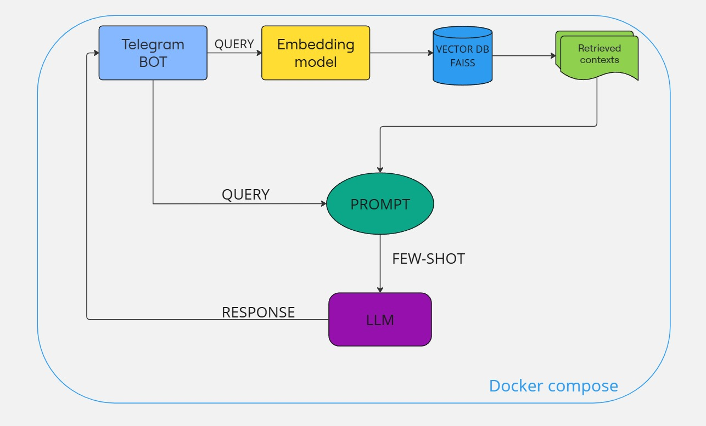

# AI Pizza Bot на основе Retrieval Augmented Generation (RAG)

Telegram-бот, который собирает корзину заказа по текстовому или голосовому сообщению.
Голос распознаётся Whisper, корзину собирает LLM (Qwen3 в vLLM) по похожим примерам из базы.



## Как это работает

1. **ASR** (только для голосовых): [whisper-large-v3-russian](https://huggingface.co/antony66/whisper-large-v3-russian), аудио декодируется в памяти.
2. **Retrieval**: `data/formatted_data.json` — ~1750 пар «запрос → список товаров». Каждая пара — **один документ**
   с текстом `запрос: ["товар", ...]`, эмбеддинги [LaBSE-ru-turbo](https://huggingface.co/sergeyzh/LaBSE-ru-turbo),
   FAISS, cosine similarity, `k=12`.
3. **Генерация со structured output**: в промпт идут правила + полное меню (статичный префикс, кэшируется vLLM)
   и найденные примеры. LLM возвращает JSON по Pydantic-схеме:
   ```json
   {"items": [{"name": "Пепперони Medium", "quantity": 2}], "comment": null}
   ```
   Поле `name` — enum из 466 товаров меню, поэтому при constrained decoding (vLLM) модель **физически не может**
   вернуть несуществующий товар.
4. **Постобработка**: склейка дублей, сверка с каталогом, рендер корзины. Цены выводятся, только если положить
   `bot/data/prices.json` (`{"Пепперони Medium": 599, ...}`) — в датасете цен нет, поэтому LLM их больше не выдумывает.

## Демонстрация
[](https://www.youtube.com/watch?v=xEU5VpRfEIs)

## Структура

```
docker-compose.yaml
vllm/Dockerfile            # vLLM с фиксом torchcodec
bot/
  data/formatted_data.json # примеры запрос -> товары (+ опционально prices.json)
  pizza_bot/               # python -m pizza_bot
    __main__.py            # точка входа
    app.py                 # сборка зависимостей, запуск polling
    config.py              # настройки из env (pydantic-settings)
    catalog.py             # загрузка датасета, нормализация названий, каталог, цены
    retriever.py           # FAISS-индекс и поиск примеров
    cart.py                # корзина и её рендер
    asr.py                 # Whisper
    llm/
      schemas.py           # Pydantic-схемы structured output
      prompts.py           # промпты и форматирование примеров
      chain.py             # RAG-цепочка: поиск -> LLM -> корзина
    telegram/
      handlers.py          # aiogram-хендлеры
      texts.py             # тексты сообщений
  scripts/evaluate.py      # оценка retrieval и end-to-end
```

## Запуск

```bash
git clone https://github.com/Shoxiing/get_pizza && cd get_pizza
cp .env.example .env    # TELEGRAM_BOT_API_KEY, HF_TOKEN, LLM_MODEL
docker compose up --build
```

Поднимутся два контейнера: `vllm` (OpenAI-совместимый сервер с LLM) и `telegram_bot`.
По умолчанию vLLM берёт ~72% VRAM, остальное остаётся под Whisper (рассчитано на 24 ГБ).

### Внешняя LLM вместо локального vLLM

Подойдёт любой OpenAI-совместимый endpoint, например HF Inference Providers. Задайте в `.env`
`LLM_BASE_URL`, `LLM_API_KEY`, `LLM_MODEL` (пример в `.env.example`) и запустите только бота:

```bash
docker compose up --build --no-deps telegram_bot
```

## Оценка качества

Скрипт запускается в контейнере бота: там уже есть зависимости и доступ к vLLM.

```bash
# leave-one-out: доля товаров правильной корзины, которые есть в найденных примерах
docker compose run --rm --no-deps telegram_bot python -m scripts.evaluate retrieval
# end-to-end на отложенных запросах (их нет в индексе); поднимет vLLM, если он не запущен
docker compose run --rm telegram_bot python -m scripts.evaluate e2e --n 150
```
